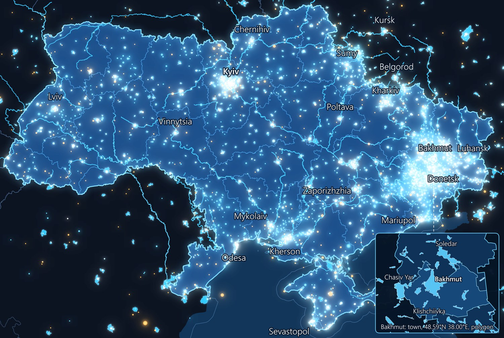
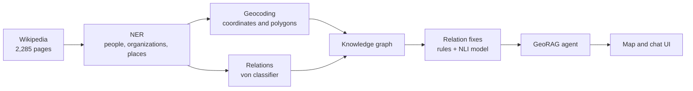
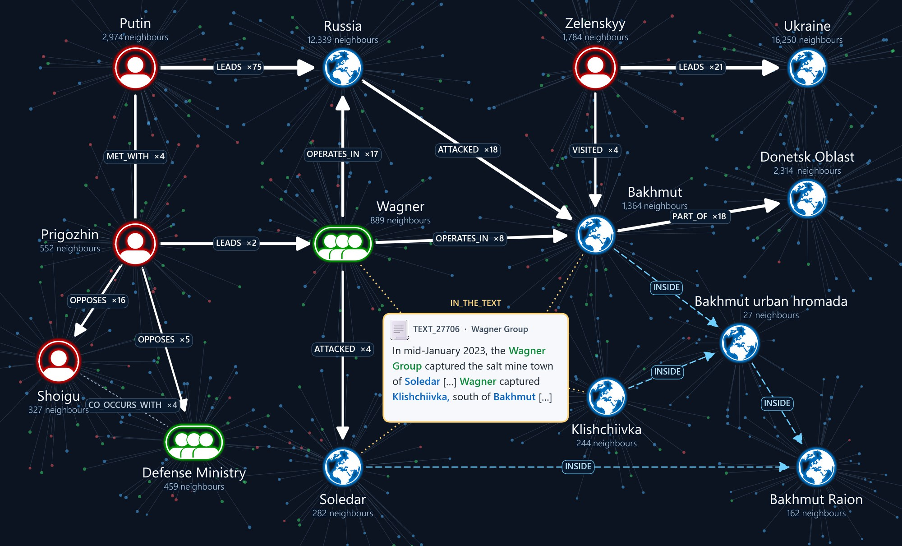

# Corpus2GeoRAG

Ask a question about the Russia–Ukraine war and get the answer on a map, with every place and statement traced back to the Wikipedia text it came from.

The project turns English Wikipedia articles into a knowledge graph that knows where things are, then puts a question-answering agent and an interactive map on top of it.



*Every point, line and polygon is a place name found in the corpus and geocoded by the pipeline: about 4,700 in this frame. Point size: mentions in the corpus. White: cities. Blue: towns and villages. Amber: other sites. Zoom: the polygons around Bakhmut.*

## From articles to answers



| Stage | Folder | Result |
|---|---|---|
| Corpus | [`CollectCorpus/`](CollectCorpus/README.md) | 2,285 pages, 88,120 paragraphs |
| Named entities | [`ApplyNER/`](ApplyNER/README.md) | 490,894 mentions, 333,154 of them people, organizations and places |
| Geocoding | [`Graph_n_Geocoding/`](Graph_n_Geocoding/KNOWLEDGE_GRAPH_README.md) | 11,230 of 14,903 place names located (75%) |
| Knowledge graph | [`Graph_n_Geocoding/`](Graph_n_Geocoding/KNOWLEDGE_GRAPH_README.md) | 154,486 nodes, 798,102 edges, 101,674 typed relations |
| Agent | [`AgentRag/`](AgentRag/AgentRag_README.md) | Answers from the graph only, with citations |
| Interface | [`ui/`](ui/README.md) | Streamlit app: chat, map and sources side by side |

## Run it

On Windows, double-click **`RUN_GEORAG.bat`**. The first run installs everything and asks once for an [OpenRouter API key](https://openrouter.ai/keys), which is saved locally and never uploaded. Clone the repo into a short folder such as `C:\GeoAi`, because some paths are long.

If you want to run the app using your CMD, you can run the following commands:

``` sh
git clone https://github.com/EtzionR/Corpus2GeoRAG.git
cd Corpus2GeoRAG\ui
pip install -r requirements.txt
streamlit run app.py
```

## 1. Corpus

The corpus is built from Wikipedia category trees and seed pages, then expanded through page links.

- **Selector:** each candidate page is split into paragraphs, embedded with EmbeddingGemma 2 and scored by a logistic regression trained on 3,009 paragraphs. In testing, 92.3% of accepted pages were correct.
- **Result:** 2,285 of 5,827 candidate pages, about 4.2 million words.
- **Updates:** only pages that changed on Wikipedia are downloaded again.

## 2. Named entities

Several NER models (DistilBERT, BERT, RoBERT, Flair, GLiNER) were compared on 10% of the data, against ground truth generated with Cohere and Llama. The pipeline runs [`flair/ner-english-large`](https://huggingface.co/flair/ner-english-large), and later runs process only new or changed pages.

The graph uses the 333,154 `PER`, `ORG` and `LOC` mentions. The other 157,740 are `MISC`.

## 3. Geocoding

NER returns place names as plain text, and many are ambiguous: Donetsk is both a city and an oblast.

- **Search:** [Nominatim](https://nominatim.org/) (OpenStreetMap) returns up to 5 candidates per name.
- **Re-ranking:** places in Ukraine and Russia come first when they are close in importance to the top match, and a city beats an oblast with the same name.
- **Polygons:** simplified according to the size of each place, from 422 MB to 21 MB when measured on an earlier set of 13,528 names.
- **Reuse:** about 4 hours from scratch (1 request per second), about 15 seconds when no name is new.
- **Corrections:** 15 wrong matches were fixed by hand, for example `Kremlin`, which had matched a neighbourhood in Tula.

| Result | Count |
|---|---|
| Place names located | 11,230 of 14,903 (75%) |
| Polygons | 8,134 |
| Points and lines | 3,096 |
| `INSIDE` links computed from polygons | 10,896 |

## 4. Knowledge graph

The graph links 66,366 entities to each other and to the 88,120 paragraphs they come from, so any relation can be traced to its exact words.



*14 entities and 1 text out of 154,486 nodes. White: relations read from the text, ×n = records. Dashed blue: `INSIDE`, from polygons. Dotted yellow: `IN_THE_TEXT`.*

- **Pairs:** two entities in the same sentence and at most 100 characters apart are sent to the classifier. Other pairs, and items of one comma list, are stored as `CO_OCCURS_WITH`.
- **Classifier:** `von` picks one of 20 relation types from the sentence, including who acts. It made 254,949 unique decisions, and its results are saved so later runs only classify what is new.
- **Geometry:** `INSIDE` links come from the polygons, not from the text, and connect each place to the smallest place that contains it.
- **Weights:** edges are stronger when two entities appear close together, often and in many articles.

## 5. Relation fixes

On its own, `von` was right on only 51% of typed relations, so the built graph goes through a cleanup. Rules remove 638 junk names and correct patterns `von` misreads, such as lists. Then an [NLI model](https://huggingface.co/MoritzLaurer/DeBERTa-v3-large-mnli-fever-anli-ling-wanli) checks whether each sentence really states its relation; if not, the relation becomes `CO_OCCURS_WITH`. Together they changed 42,914 records and raised accuracy on typed relations to 72% ±6, and on all records from a sentence from 63% to 77% ±4. This was measured on 600 new cases labelled by Claude, an AI model, and not yet checked by a person.

We suggest that the RAG accepts relations at confidence ≥ 0.5 rather than its current 0.7. This keeps almost twice as many relations, and the drop in accuracy is within the margin of error. Details are in the [graph README](Graph_n_Geocoding/KNOWLEDGE_GRAPH_README.md).

## 6. The agent

The agent answers from the graph only, in six steps:

| Step | What happens | Uses the LLM? |
|---|---|---|
| Understand | The question becomes a plan: its type, names, relations and map area | Yes; simple questions skip it |
| Resolve | Names become graph entries: "Kiev" → Kyiv | Only to choose between real candidates |
| Retrieve | A fixed route per question type walks the graph | No |
| Evidence | Picks the least text that answers the question | No |
| Write | Writes the answer with citations, and code removes any citation that points at nothing | Yes |
| Result | Builds the numbered places, outlines and sources for the map | No |

Coordinates and sources always come from the graph, never from the LLM. In the latest run of 14 test questions on Gemini 2.5 Flash, questions that needed the LLM took 2.9 seconds on average, and the whole run cost about $0.02. Every design choice and its evidence is in the [decisions log](AgentRag/DECISIONS_LOG.md).

## 7. The interface

A Streamlit app connects a chat console with a Folium map over Ukraine:

- **Ask with the map:** click a point or draw an area, and the question applies to that area.
- **See the answer in place:** pins and polygon outlines appear, and the map zooms to fit them.
- **Check the source:** citations open the original passage with the relevant words highlighted.

## Known limits

- **Spellings are not unified:** `Kyiv`, `Kiyev` and `Kiev` are separate nodes.
- **Geocoding:** about 25% of place names were not found, and located does not always mean correct. `Donbas`, for example, matched a street in Skopje. Geocoding accuracy has not been measured.
- **Relations:** some types remain weak, such as `LOCATED_IN` (30%) and `CONTROLS` (45%), though on only 10 or 11 samples each.
- **Evaluation:** the relation accuracy above still needs a human check.

## License

[Apache 2.0](LICENSE)
