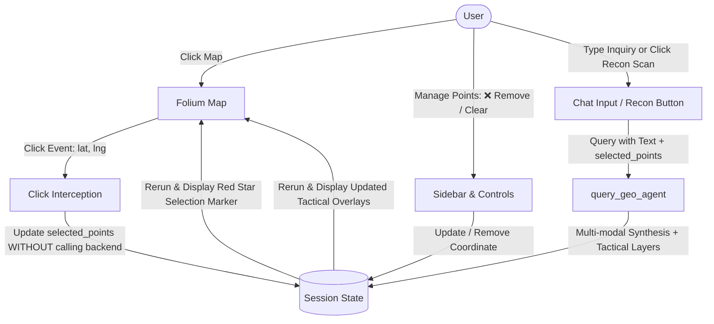

# 🌍 GeoAI Final Project - Spatial Intelligence Frontend & RAG Contract

A complete, production-ready Streamlit frontend and mock RAG backend contract built for the **GeoAI Final Project**. Features a synchronized split-screen architecture combining an interactive **Folium map of Ukraine** with an **AI chat interface**, supporting bi-directional spatial updates and automated multi-modal query routing.

---

## 🚀 Quick Start for Team Members

This repository is configured to be completely **self-bootstrapping**. Any team member who clones this folder can run the application immediately on any operating system.

### Option 1: Double-Click Launcher (Windows)
Simply double-click the included batch file in the `ui/` folder:
```text
run_app.bat
```
*This script will automatically check for Python, create a virtual environment (`.venv`), install all requirements, and open the app in your browser.*

### Option 2: Linux / macOS Launcher
Open your terminal in the `ui/` folder:
```bash
chmod +x run_app.sh
./run_app.sh
```

### Option 3: Manual Command Line Execution
```bash
# Navigate to ui/ directory
cd ui

# 1. Create and activate a virtual environment
python -m venv .venv

# On Windows:
.venv\Scripts\activate
# On Linux/macOS:
source .venv/bin/activate

# 2. Install dependencies
pip install -r requirements.txt

# 3. Launch Streamlit
streamlit run app.py
```
*(Alternatively, simply running `python app.py` will auto-detect the environment and launch Streamlit).*

---

## 🏛️ Architecture & Component Overview

```
ui/
├── app.py              # Main Streamlit frontend (Chat, Folium map, session state, adjustable layout)
├── geo_agent.py        # Backend contract (MapLayer, AgentResponse, query_geo_agent router)
├── test_app.py         # Pytest test suite validating contract typing and all query scenarios
├── requirements.txt    # Project dependencies specification
├── run_app.bat         # Automated one-click Windows launcher (venv setup + dependency check)
├── run_tests.bat       # Automated one-click Windows test runner
├── run_app.sh          # Automated Unix/macOS launcher
├── .gitignore          # Git exclusion rules for Python, virtual environments, and caches
└── README.md           # UI documentation and architectural guide
```

---

## 🔄 Bi-Directional State Synchronization Flow

The application bridges the conversational chat interface and the geospatial Folium map using `st.session_state`:



1. **Decoupled Map Click Selection (Bounding Box vs. Point Selection)**:
   - Clicking on the map selects coordinates without triggering immediate backend queries.
   - **Bounding Box Mode (Default)**: Clicking two points calculates and saves a standardized two-point bounding box `(lower-left, upper-right)`:
     - Point 1 (Lower-Left / South-West): `(min_lat, min_lng)`
     - Point 2 (Upper-Right / North-East): `(max_lat, max_lng)`
     - Visualized immediately on Folium with directional arrow markers and a dashed tactical rectangle. Clicking again starts a fresh bounding box.
   - **Point Selection Mode**: Clicking on the map selects a single coordinate. Clicking again cancels the previous selection and selects the new point (no multi-point accumulation).

2. **Selected Point & Bounding Box Management**:
   - In the sidebar and chat status panel, the active selection is displayed with clear coordinates and `❌` removal buttons.
   - For bounding boxes, Lower-Left and Upper-Right corners can be inspected, removed individually, or cleared simultaneously.
   - A `🗑️ Clear All` / `🗑️ Clear Box` button removes the active selection in a single click.
   - Tactical map layers from prior query results can also be inspected and removed individually.

3. **Targeted Follow-Up Text Queries**:
   - With one or more coordinates selected, the user enters an inquiry in the chat (e.g., *"What units are stationed here?"*).
   - The frontend routes the prompt and selected points to `query_geo_agent` under **Scenario A**.
   - The agent returns a synthesized response referencing both the user intent and coordinates, alongside tactical buffer layers.

4. **On-Demand Reconnaissance Scan**:
   - If the user desires a reconnaissance summary without typing a prompt, they can explicitly click **🔍 Run Reconnaissance** from the sidebar or chat banner (Scenario B).

5. **General Spatial Query**:
   - If no coordinate is selected, asking general questions (e.g., *"Show logistics corridors"*) triggers **Scenario C**, returning strategic regional intelligence markers across Kyiv, Kharkiv, and Dnipro.

---

## 🧩 Backend Contract (`geo_agent.py`)

### `MapLayer` Dataclass
Represents an individual visual layer rendered on the Folium map:
```python
@dataclass
class MapLayer:
    name: str
    layer_type: str                     # 'marker', 'circle', 'polygon', or 'geojson'
    data: Any                           # e.g., {'lat': 48.5, 'lng': 31.2, 'radius': 15000}
    color: str = "blue"
    tooltip: str = ""
    popup: str = ""
```

### `AgentResponse` Dataclass
Standardized multi-modal response object:
```python
@dataclass
class AgentResponse:
    answer: str                         # Markdown natural language synthesis
    layers: List[MapLayer]              # Geospatial layers to render
```

### Routing Entrypoint
```python
def to_bounding_box(
    p1: Tuple[float, float],
    p2: Tuple[float, float]
) -> Tuple[Tuple[float, float], Tuple[float, float]]:
    """Standardizes two coordinates into ((min_lat, min_lng), (max_lat, max_lng))."""

def query_geo_agent(
    text_prompt: Optional[str] = None,
    clicked_point: Optional[Tuple[float, float]] = None,
    chat_history: Optional[List[Dict[str, Any]]] = None,
    selected_points: Optional[List[Tuple[float, float]]] = None,
    bounding_box: Optional[Tuple[Tuple[float, float], Tuple[float, float]]] = None
) -> AgentResponse:
```

---

## 🧪 Automated Testing (`pytest`)

To run the automated test suite and validate all contract scenarios:

```bash
# Using Python module runner
python -m pytest test_app.py -v

# Or double-click:
run_tests.bat
```

### Test Coverage
- `test_map_layer_instantiation_and_defaults`: Validates dataclass attributes and default parameters.
- `test_map_layer_custom_attributes`: Validates custom layer geometry and colors.
- `test_agent_response_defaults`: Validates default response contract.
- `test_scenario_a_both_text_and_clicked_point`: Verifies targeted query synthesis referencing both user prompt and coordinates, with tactical layers.
- `test_scenario_b_only_clicked_point`: Verifies automated reconnaissance summary and location layers.
- `test_scenario_c_only_text_prompt`: Verifies general spatial answer and strategic hub coordinates.
- `test_scenario_fallback_neither_provided`: Validates graceful fallback for empty inputs.
- `test_chat_history_preservation`: Validates conversation context handling.
- `test_scenario_a_multiple_selected_points`: Validates multi-point targeting with prompt.
- `test_scenario_b_multiple_selected_points`: Validates multi-point reconnaissance without prompt.
- `test_point_selection_and_removal_lifecycle`: Simulates adding, removing, and clearing points.
- `test_to_bounding_box_standard_ordering`: Validates lower-left (min) and upper-right (max) resolution.
- `test_to_bounding_box_reversed_ordering`: Ensures identical SW/NE box regardless of click order.
- `test_to_bounding_box_diagonal_nw_to_se`: Verifies diagonal corners resolve correctly.
- `test_to_bounding_box_coordinate_rounding`: Tests 5-decimal place geodetic precision.
- `test_query_geo_agent_with_bounding_box_and_prompt`: Verifies bounding box query synthesis and layers.
- `test_query_geo_agent_with_bounding_box_reconnaissance`: Verifies bounding box reconnaissance scan.
- `test_bounding_box_selection_lifecycle`: Simulates 2-point box selection, reset, and clear lifecycle.
- `test_mode_transitions_bbox_and_point_selection`: Validates seamless mode switching between Bounding Box and Point Selection.
- `test_point_selection_cancels_previous_on_click`: Verifies that clicking again in Point Selection mode cancels the previous coordinate and selects the new point.

---

## 🔌 Connecting Your Real RAG Backend

When your team is ready to connect the actual RAG pipeline:
1. Replace or extend the logic in `geo_agent.py` inside `query_geo_agent()`.
2. Connect your vector store (e.g., Chroma, FAISS, PGVector), spatial index (GeoPandas, PostGIS), or LLM client (e.g., Gemini, OpenAI, Claude).
3. Ensure the return object conforms to `AgentResponse(answer=..., layers=[MapLayer(...)])`.
4. The frontend in `app.py` will render the new intelligence feeds automatically without any changes needed!
